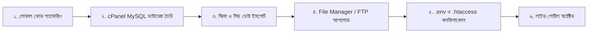

# Newslensbd (নিউজলেন্সবিডি) — Professional Bangla News Portal

> **ট্যাগলাইন (বাংলা):** সাধারণের বাইরে, সত্যের খোঁজে  
> **Tagline (English):** News Beyond the Ordinary  
> **টেকনোলজি পার্টনার:** [Stratifyx Global](https://stratifyxglobal.com)

---

## 📌 প্রজেক্ট ওভারভিউ (Project Overview)

**Newslensbd (নিউজলেন্সবিডি)** হলো সমগ্র বাংলাদেশের জাতীয়, আন্তর্জাতিক, ৮টি বিভাগ, ৬৪টি জেলা এবং উপজেলা পর্যায়ের সংবাদ প্রকাশের জন্য একটি আধুনিক, দ্রুতগতির (< ২ সেকেন্ড লোড টাইম), মোবাইল-ফার্স্ট ও এসইও-বান্ধব পেশাদার বাংলা নিউজ পোর্টাল।

---

## 🎨 ব্র্যান্ড আইডেন্টিটি ও কালার গাইডলাইন (Brand & UI Palette)

* **Primary (মূল রঙ - হেডার, শিরোনাম):** Navy Blue (`#0b1f44` / `#0B2149`)
* **Category Label (ক্যাটাগরি ব্যাজ ও লেবেল):** Green (`#0E7A3A`)
* **Breaking / Live (ব্রেকিং নিউজ ও লাইভ ব্যাজ):** Red (`#E31E24`)
* **ওয়েবসাইট লোগো:** `Newslens` (খবরের কাগজ + ক্যামেরা লেন্সের ভেতরে বাংলাদেশের মানচিত্র)
* **ডেভেলপার/পার্টনার লোগো:** `Stratifyx Global`
* **বাংলা ফন্ট:** Hind Siliguri / Noto Serif Bengali (Self-hosted)

---

## 🚀 বাস্তবায়িত ফিচারসমূহ (Implemented Modules)

### ১. মূল পোর্টাল ও হোমপেজ আর্কিটেকচার (Option 1)
* **শীর্ষবার (Top Bar):** বাংলা ও হিজরি তারিখ রূপান্তরকারী (`BanglaDate`), আবহাওয়া সূচক, রিডার টুলস (অ-, অ, অ+ ফন্ট রিসাইজার), দ্বিভাষিক সুইচ (`[বাংলা | English]`), আধুনিক স্লাইডার থিম টগল পিল (Navy Dark/Light)।
* **ডার্ক মোড (Navy Dark Mode):** কোনো পিওর ব্ল্যাক নয়, গভীর নেভি ব্লু (`#071630` / `#0c1e3d`) প্যালেট এবং `localStorage` সিঙ্কিং।
* **নেভিগেশন ও ক্যাটাগরি পেজ:** ১৪টি ক্যাটাগরির নিজস্ব আর্কাইভ পেজ (`/category/{slug}`) ও দ্রুত মেনু রাউটিং।
* **ব্রেকিং নিউজ স্লাইডশো:** লাল পালস ডট সহ প্রতি ৩.৫ সেকেন্ডে স্বয়ংক্রিয় স্লাইডার ট্রানজিশন, হোভার পজ ও ম্যানুয়াল নেভিগেশন কন্ট্রোল।
* **ভিডিও ও মাল্টিমিডিয়া লাইটবক্স:** হোমপেজে ভিডিও ক্লিক করলেই আধুনিক পপআপ মডালে ইউটিউব বা কাস্টম ভিডিও প্লেয়ার চালু হয়।
* **সিঙ্গেল আর্টিকেল ভিউ:** `/news/{category}/{id}/{slug}` পাথে বিস্তারিত সংবাদ, ক্যাটাগরি, লেখক, প্রকাশের তারিখ, ফেসবুক/হোয়াটসঅ্যাপ/এক্স ও কপি লিঙ্ক শেয়ারিং, সম্পর্কিত সংবাদ এবং তাৎক্ষণিক রিডার ভিউ কাউন্টার ট্র্যাকিং।
* **অনুসন্ধান ও বহুমুখী ফিল্টার:** `/search` পাথে শিরোনাম/কীওয়ার্ড, ক্যাটাগরি, সময়কাল (আজ, গত ৭ দিন, গত ৩০ দিন), এবং বিভাগ ও জেলা ক্যাসকেডিং ফিল্টার।
* **সাইডবার উইজেট:** ডাটাবেজ-সংযুক্ত অনলাইন পাঠক জরিপ (Poll) লাইভ ভোট ও শতাংশ বার, নিউজলেটার সাবস্ক্রিপশন, নামাজের সময়সূচি ও বিজ্ঞাপন স্লট।
* **ফুটার:** সম্পাদক ও প্রকাশকের তথ্য, সাইটম্যাপ এবং টেকনোলজি পার্টনার **Stratifyx Global** ব্র্যান্ডিং।

### ২. সারাদেশ ও জেলা ফিল্টারিং সিস্টেম (Option 2)
* **৬৪ জেলার পূর্ণাঙ্গ ডাটাবেজ:** ৮টি বিভাগ ও ৬৪টি জেলার রিয়েল ডাটাবেজ ইন্টিগ্রেশন।
* **ক্যাসকেডিং ফিল্টার (Cascading Filter):** বিভাগ নির্বাচন করলে AJAX-এর মাধ্যমে তাৎক্ষণিক সংশ্লিষ্ট জেলার তালিকা লোড।
* **জেলা সংবাদ গ্রিড:** জেলা ব্যাজ, থাম্বনেইল ও সংবাদ বিবরণী সহ সাজানো ফিড (`/saradesh`)।

### ৩. অ্যাডমিন সিএমএস ও সম্পাদকীয় প্রক্রিয়া (Admin CMS & Enhancements)
* **সুরক্ষিত নন-ডিফল্ট পাথ:** `/lens-desk` (ডিফল্ট `/admin` নয়)।
* **ডায়নামিক লোগো ও ব্র্যান্ডিং:** অ্যাডমিন হেডারে স্ট্যাটিক টেক্সটের বদলে সাইটের ডায়নামিক লোগো ও সিএমএস ব্যাজ প্রদর্শন।
* **অ্যাডমিন ডার্ক/লাইট মোড:** অ্যাডমিন হেডারে ☀️ / 🌙 থিম টগল বাটন; নেভি ব্লু ডার্ক মোড (`#071630` / `#0c1e3d`) ও ঝকঝকে হোয়াইট লাইট মোড সাপোর্ট।
* **সার্বজনীন দ্বিভাষিক অনুবাদ ইঞ্জিন (100% Bilingual BN ⇄ EN Toggle):**
  - অ্যাডমিন প্যানেলের প্রতিটি পেজের সমস্ত ইন্টারফেস এলিমেন্ট (মেনু, বাটন, ফর্ম লেবেল, প্লেসহোল্ডার, ড্রপডাউন অপশন, টেবিল হেডার, কেপিআই মেট্রিক্স, অ্যালার্ট, মোডাল ও ফুটার) এক ক্লিকে বাংলা অথবা ইংরেজিতে রূপান্তরিত হয়।
  - **ব্যবহারকারীর শর্তানুযায়ী সংরক্ষিত:** প্রকাশিত নিউজের মূল শিরোনাম ও খবরের বডি টেক্সট অপরিবর্তিত থাকে; বাকি সমস্ত ফ্রেমওয়ার্ক ও সিএমএস এলিমেন্ট দ্বিভাষিক নিয়মে নিয়ন্ত্রিত।
  - `localStorage` ও কুকি মেমোরি সিঙ্কিংয়ের ফলে পেজ রিফ্রেশ বা নতুন ট্যাবে ব্রাউজ করলেও ব্যবহারকারীর নির্বাচিত ভাষা সংরক্ষিত থাকে।
* **লগইন স্ক্রিনে ডায়নামিক বাংলাদেশ ভেক্টর ম্যাপ (Interactive Bangladesh Vector Map):**
  - লগইন স্ক্রিনের বাম প্যানেলে নদী (পদ্মা, মেঘনা, যমুনা, কর্ণফুলী) ও বঙ্গোপসাগর সহ নিখুঁত স্কেলযোগ্য SVG ভেক্টর ম্যাপ।
  - **থিম ভিত্তিক রঙ পরিবর্তন:** ডার্ক মোডে লাল (`#E31E24`) এবং লাইট মোডে জাতীয় সবুজ (`#0E7A3A`) রঙে রেন্ডার হয়; নদী ও সাগর সর্বদা ন্যাচারাল ব্লু ওয়াটার কালারে প্রদর্শিত।
  - ৮টি প্রশাসনিক বিভাগের ইন্টারঅ্যাক্টিভ পিন এবং রাজধানী ঢাকার পালসিং লোকেশন বীকন।
  - ডায়নামিক পাসওয়ার্ড ভিজিবিলিটি টগল (Eye Button) সহ লাইট/ডার্ক মোড সিঙ্কিং।
* **লেখক / বাইলাইন বহুবিধ নির্বাচন সিস্টেম (Multi-Author & Byline Attribution):**
  - সংবাদ তৈরি ও সম্পাদনার সময় ৩ ধরনের লেখক সিলেকশন ব্যবস্থা:
    1. **অ্যাকাউন্ট নাম (Account Name):** লগইনকৃত অ্যাডমিনের নাম সরাসরি লেখক হিসেবে যাবে।
    2. **বেনামী (Anonymous):** প্রকাশকের পরিচয় গোপন রেখে নিউজ পাবলিশের সুবিধা।
    3. **অন্য নাম / কাস্টম বাইলাইন (Custom Byline):** বিশেষ প্রতিনিধি, নিজস্ব প্রতিবেদক, বা যেকোনো কাস্টম সাংবাদিকের নাম ব্যবহারের সুবিধা।
  - ফ্রন্টএন্ড নিউজ কার্ড এবং সিঙ্গেল নিউজ পেজেও নির্বাচিত লেখকের নাম প্রদর্শিত হয়।
* **নতুন ক্যাটাগরি সংযোজন:** মূল তালিকায় **অপরাধ (Crime)** ক্যাটাগরি যুক্ত করা হয়েছে।
* **রেসপনসিভ ৩-লাইন হ্যামবার্গার ও অফক্যানভাস ড্রয়ার (Drawer Navigation):**
  - অ্যাডমিন হেডারে অপ্রয়োজনীয় ডুপ্লিকেট বাটন অপসারণ করে একটি মার্জিত ৩-লাইন হ্যামবার্গার মেনু (`☰`) যুক্ত।
  - ক্লিক করলে মসৃণ অফক্যানভাস সাইডবার ড্রয়ার ওপেন হয়, যেখানে সমস্ত মেনু, ভাষা সুইচ, থিম ও অ্যাকশন সুবিন্যস্ত।
* **অ্যাডমিন নাম ও প্রোফাইল দ্রুত পরিবর্তন মোডাল:**
  - হেডার ইউজার পিল বা ড্রয়ার থেকে এক ক্লিকেই সুপার অ্যাডমিনের নাম, মোবাইল ও পাসওয়ার্ড সম্পাদনার জন্য পপআপ মোডাল।
* **নতুন অনলাইন জরিপ তৈরি ও পরিচালনা (`/lens-desk/polls`):**
  - কাস্টম প্রশ্ন ও একাধিক অপশন দিয়ে নতুন অনলাইন জরিপ তৈরির পূর্ণাঙ্গ ফর্ম।
  - তৈরি করা জরিপ হোমপেজে সক্রিয় (Set Active) করার সুবিধা।
  - মোট ভোট সংখ্যা শূন্য (০) করার জন্য "ভোট রিসেট" অপশন এবং ডিলিট সুবিধা।
* **সবচেয়ে বেশি পঠিত সংবাদ (Most Viewed News Analytics):** ড্যাশবোর্ডে পাঠকদের সর্বাধিক পছন্দের শীর্ষ খবরের লাইভ র‍্যাংকিং ও ভিউ কাউন্ট কার্ড।
* **সংবাদ ব্যবস্থাপনা ও লাইভ স্ট্যাটাস ফিল্টার (`/lens-desk/posts`):**
  - প্রকাশিত, পেন্ডিং ও খসড়া সংবাদের ক্যাটাগরি ও জেলা ফিল্টারিং, ড্রাফট সেভ, এডিটর রিভিউ সাবমিশন ও ডিরেক্ট পাবলিশ।
  - ছবি আপলোড (লোকাল ডিভাইস থেকে কিংবা সরাসরি ওয়েব URL) এবং ইউটিউব ভিডিও লিঙ্ক সাপোর্ট।
* **বিজ্ঞাপন ব্যবস্থাপনা ও অ্যানালিটিক্স কন্ট্রোল (`/lens-desk/ads`):**
  - ৫টি রিয়েলটাইম কেপিআই মেট্রিক্স: সর্বমোট বিজ্ঞাপন, চলমান সক্রিয়, মোট ভিউ, মোট ক্লিক এবং ক্লিক রেট (CTR)।
  - পোর্টাল নির্ধারিত সাইজ গাইডলাইন (হেডার: ৭২৮×৯০, ইন-ফিড: ৭২৮×৯০/৯৭০×৯০, সাইডবার: ৩০০×২৫০, ফুটার: ৯৭০×৯০)।
  - ব্যানার ও কাস্টম হাইপারলিংক (Destination URL) ট্র্যাকিং এবং সক্রিয়/নিষ্ক্রিয় স্ট্যাটাস টগল।
* **নিউজলেটার গ্রাহক তালিকা (`/lens-desk/subscribers`):** সাবস্ক্রাইবারদের ইমেইল তালিকা, সাবস্ক্রিপশন তারিখ ও ম্যানেজমেন্ট।
* **সাইট ব্র্যান্ডিং, লোগো ও ফুটার তথ্য ব্যবস্থাপনা (`/lens-desk/settings`):**
  - সাইট লোগো এবং টেকনোলজি পার্টনার লোগো আপলোড ও URL পরিবর্তন।
  - ভারপ্রাপ্ত সম্পাদক ও প্রকাশকের নাম (বাংলা ও ইংরেজি)।
  - সরকারি নিবন্ধন তথ্য (তথ্য ও সম্প্রচার মন্ত্রণালয়)।
  - হেড অফিস ঠিকানা (বাংলা ও ইংরেজি), যোগাযোগ ফোন নম্বর এবং ইমেইল।
  - সোশ্যাল মিডিয়া লিংক (Facebook, YouTube, X) এবং কপিরাইট টেক্সট সম্পাদন।
* **ইউনিফাইড ৪-কলাম অ্যাডমিন ফুটার (Unified Admin Footer):**
  - পাবলিক সাইটের সাথে শতভাগ সামঞ্জস্যপূর্ণ প্রিমিয়াম ৪-কলাম ফুটার (ব্র্যান্ড ও এডিটোরিয়াল, ক্যাটাগরি, প্রতিষ্ঠান, যোগাযোগ ও অফিস)।
  - হোয়াইট ব্যাকগ্রাউন্ড ব্যাজে সাইট লোগো এবং টেকনোলজি পার্টনার **Stratifyx Global**-এর ব্র্যান্ডিং উপস্থাপন।
* **লেখক ব্যবস্থাপনা ও অনুমোদন ব্যবস্থা (Writer Role & Approval System):**
  - **লেখক নিবন্ধন (`/writer/register`):** নাম, ইমেইল, মোবাইল, পাসওয়ার্ড, সংক্ষিপ্ত পরিচিতি (Bio) ও লেখার আগ্রহ উল্লেখ করে বাংলা আবেদন ফর্ম।
  - **ইমেইল ওটিপি যাচাই (`/otp/verify`):** নিবন্ধনের পর স্বয়ংক্রিয়ভাবে ৬-সংখ্যার ওটিপি প্রেরিত হয় (১০ মিনিট মেয়াদ, ৬০ সেকেন্ড কুলডাউন, প্রতি ঘণ্টায় সর্বোচ্চ ৫টি কোড)।
  - **অ্যাডমিন রিভিউ পেজ (`/writer/pending`):** ওটিপি যাচাই শেষে অ্যাকাউন্টটি `pending` অবস্থায় থাকে। অ্যাডমিনের অনুমোদন না পাওয়া পর্যন্ত লেখক পোস্ট তৈরি করতে পারবেন না।
  - **অ্যাডমিন রাইটার কন্ট্রোল (`/lens-desk/writers`):** 
    - পেন্ডিং আবেদন অনুমোদন (Approve) করার সময় পারমিশন লেভেল নির্ধারণ: **সরাসরি প্রকাশ (Direct Publish)** অথবা **সম্পাদকীয় পর্যালোচনা (Editor Review)**।
    - সুনির্দিষ্ট কারণ উল্লেখ করে আবেদন বাতিল (Reject) করার ব্যবস্থা।
    - যেকোনো সময় লেখকের স্ট্যাটাস সাময়িক স্থগিত (Suspend) কিংবা প্রত্যাহার (Reactivate) করার সুবিধা।
    - লেখক অপসারণের সময় তার পূর্বের প্রকাশিত খবর সংরক্ষিত রেখে সাবেক লেখক (Former Writer) হিসেবে রূপান্তরের সুরক্ষা।
    - অ্যাডমিনের প্রতিটি সিদ্ধান্তের সম্পূর্ণ অডিট লগ (`audit_logs`) সংরক্ষণ।
  - **লেখক প্যানেল (`/writer/dashboard`):** 
    - সম্পূর্ণ পৃথক ও সুরক্ষিত লেখক ইন্টারফেস।
    - মোট সংবাদ, প্রকাশিত, পর্যালোচনাধীন, প্রত্যাখ্যাত এবং মোট ভিউয়ের লাইভ কেপিআই কার্ড।
    - আমার সংবাদ তালিকা (`/writer/posts`) এবং নতুন সংবাদ রচনা (`/writer/posts/create`)।
    - **কঠোর মালিকানা নিরাপত্তা (Strict Ownership):** কোনো লেখক অন্য লেখকের পোস্ট দেখতে, সম্পাদনা বা ডিলিট করতে পারেন না।
* **প্রোফাইল ও ৩০-দিনের ভিউ অ্যানালিটিক্স (`/profile`):**
  - নিজস্ব প্রোফাইল ফটো/অ্যাভাটার আপলোড, বায়ো, সোশ্যাল মিডিয়া লিঙ্ক ও পাসওয়ার্ড পরিবর্তনের সম্পূর্ণ সেলফ-সার্ভিস পেজ।
  - **৩০-মিনিট ডুপ্লিকেট প্রতিরোধক ভিউ ট্র্যাকিং:** প্রতিটি সংবাদের ইউনিক ভিউ হ্যাসড আইপি (`post_views`) দিয়ে সুরক্ষিত। একই ডিভাইস থেকে ৩০ মিনিটের মধ্যে বারবার রিফ্রেশ করলে ফেক ভিউ কাউন্ট হবে না।
  - গত ৩০ দিনের দৈনিক ভিউ ট্রেন্ডের জন্য ক্যানভাস লাইন চার্ট এবং ক্যাটাগরিভিত্তিক সংবাদ ও ভিউ পরিসংখ্যান।
  - **পাবলিক লেখক পেজ (`/author/{id}`):** লেখকের সম্পূর্ণ বায়ো, সামাজিক যোগাযোগ লিঙ্ক এবং তার সকল প্রকাশিত প্রতিবেদনের গ্রিড তালিকা। প্রতিটি সিঙ্গেল নিউজ পেজের বাইলাইনে ক্লিক করলে সরাসরি এই পেজ ওপেন হয়।
* **সাধারণ পাঠক অ্যাকাউন্ট ও বুকমার্ক ব্যবস্থা (Reader Accounts & Bookmarks):**
  - সাধারণ পাঠকদের জন্য ইমেইল ওটিপি ভেরিফায়েড রেজিস্ট্রেশন (`/register`) ও লগইন (`/login`)।
  - সিঙ্গেল নিউজ পেজে এক ক্লিকেই খবর সংরক্ষণের জন্য ইন্টারেক্টিভ বুকমার্ক বাটন (🔖)।
  - সংরক্ষিত সকল সংবাদের সুবিন্যস্ত তালিকা দেখার পেজ: `/user/bookmarks`।
* **ব্রেকিং নিউজ নোটিফিকেশন ও পুশ (Notifications & Web Push):**
  - পোর্টালের হেডারে আনরিড কাউন্টার ব্যাজসহ লাইভ নোটিফিকেশন বেল ড্রপডাউন (🔔)।
  - PWA সার্ভিস ওয়ার্কার (`/sw.js`) ও ব্যাকগ্রাউন্ড পুশ সাপোর্ট (`/manifest.json`)।
  - অ্যাডমিন কর্তৃক কোনো সংবাদ 'ব্রেকিং নিউজ' হিসেবে প্রকাশিত হওয়ামাত্রই সকল সক্রিয় গ্রাহক ও পাঠকদের মাঝে রিয়েলটাইম ব্রডকাস্ট নোটিফিকেশন ডিসপ্যাচ।
  - ব্যাকগ্রাউন্ড কিউ প্রসেসিংয়ের জন্য সিএলআই ওয়ার্কার: `cron/send_notifications.php`।
---

## 🛠 প্রযুক্তি কাঠামো (Tech Stack)

| স্তর | প্রযুক্তি |
|---|---|
| **Frontend** | HTML5, Vanilla CSS3 (কাস্টম ডিজাইন সিস্টেম), Vanilla ES6+ JavaScript |
| **Backend** | PHP 8.2+ (কাস্টম Lightweight MVC আর্কিটেকচার, PSR-4 Autoloading, PDO Prepared Statements) |
| **Database** | MySQL 8.0+ / MariaDB (`utf8mb4_unicode_ci` বাংলা ফন্টের নিখুঁত সংরক্ষণে) |
| **Admin Route** | `/lens-desk` |
| **Web Server** | Apache / Nginx (Linux VPS, ন্যূনতম 2 vCPU, 4 GB RAM, SSD) |
| **CDN & Security** | Cloudflare CDN, SSL/HTTPS বাধ্যতামূলক, CSRF Protection, XSS Filtering |

---

## 🗂 ডিরেক্টরি কাঠামো (Directory Structure)

```text
NewsLens/
├── public/                 # শুধুমাত্র এটাই ওয়েব রুট (Web Root)
│   ├── index.php           # ফ্রন্ট কন্ট্রোলার ও রাউটার এন্ট্রি পয়েন্ট
│   ├── assets/             # CSS, JS, Images, Fonts
│   │   ├── css/style.css   # মাস্টার স্টাইলশিট (Dark mode, Brand colors)
│   │   ├── js/main.js      # ভ্যানিলা স্ক্রিপ্ট (Ticker, Tabs, Font sizing)
│   │   └── img/            # লোগো ও ছবি
│   └── uploads/            # খবরের আপলোডকৃত ছবি (বছর/মাস অনুসারে)
├── app/
│   ├── Controllers/        # HomeController, SaradeshController, Admin/*
│   ├── Models/             # Post, Category, District, Setting
│   ├── Views/              # এমভিসি টেমপ্লেট ভিউ
│   │   ├── layouts/        # main.php
│   │   ├── partials/       # header.php, breaking_ticker.php, footer.php
│   │   ├── pages/          # home.php, saradesh.php
│   │   └── admin/          # login.php, dashboard.php, posts_index.php, post_create.php
│   ├── Core/               # Router, Database, Auth, View
│   └── Helpers/            # BanglaDate (বাংলা তারিখ, সংখ্যা ও সময়)
├── config/
│   ├── config.php          # এপ্লিকেশন কনফিগারেশন
│   └── .env.example        # এনভায়রনমেন্ট টেমপ্লেট
├── database/
│   ├── schema.sql          # সম্পূর্ণ প্রোডাকশন ডেটাবেজ স্কিমা (২০টি টেবিল)
│   └── seed_initial.sql    # ৮ বিভাগ, ১৪টি ক্যাটাগরি ও ডিফল্ট সেটিংস সিড
├── storage/                # ফাইল ক্যাশ, লগ এবং ব্যাকআপ
└── README.md               # প্রজেক্ট ডকুমেন্টেশন
```

---

## 🔑 অ্যাডমিন লগইন ও রেজিস্ট্রেশন ক্রেডেনশিয়াল (Admin Authentication)

* **অ্যাডমিন লগইন ইউআরএল:** [http://localhost/NewsLens/public/lens-desk/login](http://localhost/NewsLens/public/lens-desk/login)
* **নতুন অ্যাকাউন্ট রেজিস্ট্রেশন ইউআরএল:** [http://localhost/NewsLens/public/lens-desk/register](http://localhost/NewsLens/public/lens-desk/register)
* **রেজিস্ট্রেশন ফিল্ডস:** নাম (Name), ফোন নম্বর (Phone), ইমেইল (Email), পাসওয়ার্ড (Password), কনফার্ম পাসওয়ার্ড (Confirm Password)।
* **ডিফল্ট সুপার অ্যাডমিন ইমেইল:** `admin@newslensbd.com`
* **ডিফল্ট পাসওয়ার্ড:** `password123`
* **মোবাইল রেসপন্সিভ ড্রয়ার:** স্ক্রিন বা ট্যাব ছোট করলে ৩-লাইন হ্যামবার্গার বার (`☰`) প্রদর্শিত হয় এবং ক্লিক করলে পাশ থেকে স্লাইড-ইন অফক্যানভাস ড্রয়ার ওপেন হয়।
* **অ্যাডমিন নাম পরিবর্তন সুবিধা:** সুপার অ্যাডমিন বা যেকোনো ইউজার হেডার বা ড্রয়ারে ক্লিক করে তাৎক্ষণিকভাবে নিজের নাম, ফোন ও পাসওয়ার্ড পরিবর্তন করতে পারেন।

---

## 💻 XAMPP ও phpMyAdmin-এ প্রজেক্ট রান করার নিয়ম (Step-by-Step Setup Guide)

### ধাপ ১: XAMPP Control Panel চালু করুন
1. আপনার কম্পিউটারে **XAMPP Control Panel** ওপেন করুন।
2. **Apache**-এর ডান পাশে থাকা **Start** বাটনে ক্লিক করুন (পোর্ট ৮০/৪৪৩ সক্রিয় হবে)।
3. **MySQL**-এর ডান পাশে থাকা **Start** বাটনে ক্লিক করুন (পোর্ট ৩৩০৬ সক্রিয় হবে)।

### ধাপ ২: phpMyAdmin-এ ডেটাবেজ তৈরি ও ফাইল ইমপোর্ট
1. ব্রাউজার খুলে এই লিংকে প্রবেশ করুন: [http://localhost/phpmyadmin](http://localhost/phpmyadmin)
2. বাম পাশের মেনুর ওপরে থাকা **New** বাটনে ক্লিক করুন।
3. **Database name** বক্সে লিখুন: `newslensbd`
4. Collation ড্রপডাউন থেকে নির্বাচন করুন: `utf8mb4_unicode_ci` (বাংলা ফ্রন্টের সঠিক এনকোডিংয়ের জন্য)।
5. **Create** বাটনে ক্লিক করুন।
6. এবার বাঁ দিক থেকে `newslensbd` ডেটাবেজটির ওপর ক্লিক করুন এবং ওপরের মেনু বার থেকে **Import** ট্যাবে যান:
   * **Choose File**-এ ক্লিক করে প্রোজেক্টের `database/schema.sql` ফাইলটি নির্বাচন করুন এবং পেজের নিচে থাকা **Import / Go** বাটনে ক্লিক করুন (২০টি টেবিল তৈরি হবে)।
   * পুনরায় **Import** ট্যাবে গিয়ে `database/seed_initial.sql` ফাইলটি নির্বাচন করে **Import / Go** করুন (৮ বিভাগ, ১৪ মূল মেনু ক্যাটাগরি ও ব্র্যান্ড সেটিংস লোড হবে)।

### ধাপ ৩: `.env` ফাইল কনফিগারেশন
প্রোজেক্টের রুট ডিরেক্টরিতে `.env.example` ফাইলটি কপি করে `.env` নামে সেভ করুন:
```bash
cp .env.example .env
```
আপনার XAMPP MySQL-এ যদি কোনো পাসওয়ার্ড সেট করা থাকে, তবে `.env` ফাইলে তা আপডেট করুন:
```ini
DB_HOST=127.0.0.1
DB_PORT=3307
DB_NAME=newslensbd
DB_USER=root
DB_PASS=   # (আপনার MySQL-এ পাসওয়ার্ড না থাকলে খালি রাখুন)
```

### ধাপ ৪: ব্রাউজারে পোর্টাল ভিজিট করুন
সেটআপ সম্পন্ন হলে যেকোনো আধুনিক ব্রাউজারে নিচের ইউআরএলগুলোতে প্রবেশ করুন:

* 🌐 **মূল নিউজ পোর্টাল (Homepage):**  
  [http://localhost/NewsLens/public/](http://localhost/NewsLens/public/)
* 📍 **সারাদেশ বিভাগ ও জেলা সংবাদ (Saradesh):**  
  [http://localhost/NewsLens/public/saradesh](http://localhost/NewsLens/public/saradesh)
* 🔐 **সিএমএস অ্যাডমিন ড্যাশবোর্ড (CMS Admin Desk):**  
  [http://localhost/NewsLens/public/lens-desk](http://localhost/NewsLens/public/lens-desk)
* ⏳ **কামিং সুন পেজ (Coming Soon Page):**  
  [http://localhost/NewsLens/index.html](http://localhost/NewsLens/index.html)

---

## 🚀 লাইভ সার্ভার ডিপ্লয়মেন্ট ও পরিচালনা গাইড (Live cPanel Deployment & Workflow)

Newslensbd পোর্টালটি সফলভাবে লাইভ cPanel হোস্টিং সার্ভারে সংযুক্ত ও চালু করা হয়েছে। নিচে লাইভ লিঙ্ক ও ডিপ্লয়মেন্টের পূর্ণাঙ্গ বিবরণ দেওয়া হলো:

### 🌐 লাইভ লিঙ্কসমূহ (Live URLs)
* 📰 **মূল লাইভ ওয়েবসাইট:** [https://newslensbd.com](https://newslensbd.com)
* 📍 **সারাদেশ বিভাগ ও জেলা সংবাদ:** [https://newslensbd.com/saradesh](https://newslensbd.com/saradesh)
* 📂 **ক্যাটাগরি পেজ (যেমন: জাতীয়):** [https://newslensbd.com/category/national](https://newslensbd.com/category/national)
* ✍️ **পাবলিক লেখক পেজ (Author Profile):** [https://newslensbd.com/author/1](https://newslensbd.com/author/1)
* 🛡️ **সিএমএস অ্যাডমিন কন্ট্রোল ডেস্ক:** [https://newslensbd.com/lens-desk](https://newslensbd.com/lens-desk)
  * **অ্যাডমিন ইমেইল:** `admin@newslensbd.com`
  * **পাসওয়ার্ড:** `password123` *(লগইন করে প্রোফাইল থেকে পরিবর্তন করুন)*
* 👥 **লেখক নিবন্ধন (বাংলা আবেদন):** [https://newslensbd.com/writer/register](https://newslensbd.com/writer/register)
* 📝 **লেখক ড্যাশবোর্ড (Writer Panel):** [https://newslensbd.com/writer/dashboard](https://newslensbd.com/writer/dashboard)
* 🔑 **পাঠক / লেখক লগইন:** [https://newslensbd.com/login](https://newslensbd.com/login)
* 📝 **সাধারণ পাঠক নিবন্ধন:** [https://newslensbd.com/register](https://newslensbd.com/register)
* 🔖 **সংরক্ষিত খবর (Bookmarks):** [https://newslensbd.com/user/bookmarks](https://newslensbd.com/user/bookmarks)
* 👤 **ব্যবহারকারী প্রোফাইল ও সেটিংস:** [https://newslensbd.com/profile](https://newslensbd.com/profile)
* 🔄 **পাসওয়ার্ড রিসেট (ইমেইল ওটিপি):** [https://newslensbd.com/forgot-password](https://newslensbd.com/forgot-password)

---

### 📋 যেভাবে লাইভ সার্ভারে ডিপ্লয় করা হয়েছে (Deployment Steps Taken)



1. **ডাটাবেজ প্রস্তুতকরণ ও সিডিং:**
   - cPanel-এর **MySQL® Database Wizard** ব্যবহার করে নতুন ডাটাবেজ `lcxdiarj_newslens` এবং ইউজার `lcxdiarj_lensuser` তৈরি করে `ALL PRIVILEGES` প্রদান করা হয়েছে।
   - প্রজেক্টের `database/schema.sql` (২০টি টেবিল) এবং `database/seed_initial.sql` (৮ বিভাগ, ৬৪ জেলা, ১৪ ক্যাটাগরি ও সুপার অ্যাডমিন) একসাথে ডেটাবেজে সফলভাবে ইমপোর্ট করা হয়েছে।
   - নতুন রাইটার সিস্টেম, ওটিপি ভেরিফিকেশন, নোটিফিকেশন, বুকমার্ক এবং অডিট লগের জন্য মাইগ্রেশন সফলভাবে প্রয়োগ করা হয়েছে।

2. **প্রজেক্ট প্যাকেজিং ও আপলোড:**
   - প্রজেক্টের কোর ডিরেক্টরিগুলো (`app`, `config`, `cron`, `database`, `public`, `storage`, `vendor`) এবং সিকিউরিটি কনফিগারেশন প্যাকেজ করে cPanel সার্ভারের `public_html` ফোল্ডারে আপলোড ও স্বয়ংক্রিয়ভাবে এক্সট্র্যাক্ট করা হয়েছে।

3. **প্রডাকশন `.env` ও সিকিউরিটি কনফিগারেশন:**
   - সার্ভারে প্রডাকশন পরিবেশের জন্য `.env` ফাইল কনফিগার করা হয়েছে:
     ```ini
     APP_NAME="Newslensbd"
     APP_ENV=production
     APP_DEBUG=false
     APP_URL=https://newslensbd.com

     DB_HOST=localhost
     DB_PORT=3306
     DB_NAME=lcxdiarj_newslens
     DB_USER=lcxdiarj_lensuser
     DB_PASS=Lens#Secure2026!Db

     ADMIN_PATH=lens-desk
     ```
   - মূল রুটের `.htaccess` ফাইলে সিকিউরিটি রুলস যুক্ত করা হয়েছে যাতে সমস্ত রিকোয়েস্ট নিরাপদে ফ্রন্ট কন্ট্রোলারে যায় এবং `.env` বা সিস্টেম ফোল্ডারগুলো ব্রাউজার থেকে সরাসরি অ্যাক্সেস বন্ধ থাকে।

---

### 🛠️ সাম্প্রতিক সমস্যা সমাধান ও সিস্টেম অপ্টিমাইজেশন (Bug Fixes & Technical Optimizations)

1. **লেখক পেজে HTTP 500 ত্রুটি সমাধান (Author Page Fix):**
   - **কারণ ১ (Database Column Mismatch):** `AuthorController.php` ফাইলে `short_bio` কলাম অনুসন্ধান করা হচ্ছিল, কিন্তু ডাটাবেজের `users` টেবিলে কলামের নাম ছিল `bio`। ফলে MySQL `Unknown column 'short_bio' in 'field list'` এক্সসেপশন ছুঁড়ছিল। এটি ফিক্স করতে লাইভ ডেটাবেজে `short_bio` কলাম যুক্ত করা হয়েছে এবং কোডে নিরাপদ `COALESCE` কোয়েরি সেট করা হয়েছে।
   - **কারণ ২ (Router Prefix Normalization):** কেউ ব্রাউজারে সরাসরি `https://newslensbd.com/public/author/1` ভিজিট করলে কিংবা সার্ভার রিরাইটের কারণে `/public/` প্রিপেন্ড থাকলে রাউটারে মিসম্যাচ হতো। `Router.php`-তে পাথ নরমালাইজেশন যুক্ত করা হয়েছে যাতে `/author/1` এবং `/public/author/1` উভয় লিঙ্কই সমান মসৃণভাবে ওপেন হয়।
   - **কারণ ৩ (Session Headers Guard):** `Auth.php`-তে `session_set_cookie_params()` এক্সিকিউশনের পূর্বে `!headers_sent()` গার্ড যুক্ত করা হয়েছে যাতে যেকোনো প্রাক-আউটপুটের কারণে ওয়ার্নিং বা সেশন ত্রুটি না ঘটে।

2. **ডাইনামিক ক্যানোনিকাল পোস্ট ইউআরএল (Dynamic Post Routing):**
   - `author.php`, `bookmarks.php` এবং `writer/dashboard.php`-তে পোস্টের লিঙ্কগুলো সম্পূর্ণ এসইও-বান্ধব ক্যানোনিকাল ফরম্যাটে (`/news/{category_slug}/{id}/{slug}`) আপডেট করা হয়েছে।
   - `NewsController.php` ও `Post::findBySlug()` মেথড এমনভাবে সাজানো হয়েছে যাতে আইডি বা স্লাগ যেকোনো ফরম্যাটেই পোস্ট সঠিক ও দ্রুতগতিতে রেন্ডার হয়।

3. **রোল-ভিত্তিক অ্যাক্সেস কন্ট্রোল (RBAC Server-side Middleware):**
   - প্রতিটি প্রটেক্টেড রুট ও কন্ট্রোলারে সার্ভার-সাইড ভ্যালিডেশন নিশ্চিত করা হয়েছে (`Middleware::requireRole()`, `Middleware::requirePermission()`)। শুধু ইউআই হাইড নয়, ব্যাকএন্ডেও অননুমোদিত অ্যাক্সেস সম্পূর্ণ সুরক্ষিত।

---

### 🔄 পরবর্তীতে নতুন ফিচার বা কোড পরিবর্তন করলে কী করতে হবে? (Future Updates FAQ)

অনেক ডেভলপারেরই প্রশ্ন থাকে ভবিষ্যতে নতুন কোড বা ফিচার যোগ করলে phpMyAdmin নাকি সরাসরি সার্ভারে ফাইল দিতে হবে? উত্তরটি অত্যন্ত পরিষ্কার:

| পরিবর্তনের ধরন (Type of Change) | phpMyAdmin লাগবে? | কীভাবে সার্ভারে যুক্ত হবে? |
| :--- | :---: | :--- |
| **নতুন কোড/ফিচার/ডিজাইন (PHP, HTML, CSS, JS)** | **না (০% দরকার নেই)** | শুধু পরিবর্তিত ফাইলটি cPanel **File Manager** বা **FTP** দিয়ে সার্ভারের সংশ্লিষ্ট ফোল্ডারে আপলোড/রিপ্লেস করবেন। সাথে সাথে লাইভ হয়ে যাবে! |
| **সাধারণ নিউজ, ছবি, জরিপ বা বিজ্ঞাপন প্রকাশ** | **না (কখনোই না)** | সরাসরি আপনার অ্যাডমিন প্যানেল ([`https://newslensbd.com/lens-desk`](https://newslensbd.com/lens-desk)) থেকে পোস্ট করবেন। স্বয়ংক্রিয়ভাবে লাইভ ডেটাবেজে সেভ হবে। |
| **নতুন ডেটাবেজ টেবিল বা কলাম (Database Schema)** | **হ্যাঁ (শুধুমাত্র নতুন টেবিল লাগলে)** | যদি এমন কোনো নতুন ফিচার বানান যার জন্য নতুন SQL টেবিল তৈরি করতে হয়, তবে cPanel-এর **phpMyAdmin**-এ ঢুকে শুধু সেই নতুন `CREATE TABLE` কোয়েরিটি একবার রান করলেই হবে। |

#### দ্রুত আপডেট করার পরামর্শ (Best Practice):
1. আপনার লোকাল কম্পিউটারে XAMPP-এ কোড বা ফিচার টেস্ট করে নিন।
2. কোড ঠিক থাকলে শুধুমাত্র সেই নির্দিষ্ট ফাইলটি (যেমন `app/Controllers/...` বা `public/assets/css/style.css`) cPanel File Manager-এ গিয়ে আপলোড বা এডিট করে সেভ দিন।
3. কোনো ডেটাবেজ স্ট্রাকচার পরিবর্তন না হলে phpMyAdmin খোলার কোনো দরকার নেই!

---

### 🌐 লাইভ লিঙ্ক ও অ্যাক্সেস ডিরেক্টরি (Live Links & Access Directory)

| পোর্টাল / পেজ (Page) | লাইভ লিঙ্ক (Direct URL) | অ্যাক্সেস ভূমিকা (Access Role) |
| :--- | :--- | :--- |
| **লাইভ নিউজ পোর্টাল** | [`https://newslensbd.com/`](https://newslensbd.com/) | সর্বসাধারণ (Public Readers) |
| **অ্যাডমিন কমান্ড ডেস্ক লগইন** | [`https://newslensbd.com/lens-desk/login`](https://newslensbd.com/lens-desk/login) | Super Admin (`admin@newslensbd.com` / `password123`) |
| **অ্যাডমিন ড্যাশবোর্ড** | [`https://newslensbd.com/lens-desk`](https://newslensbd.com/lens-desk) | Admin / Editor |
| **লেখক অনুমোদন ও নিয়ন্ত্রণ** | [`https://newslensbd.com/lens-desk/writers`](https://newslensbd.com/lens-desk/writers) | Admin |
| **লেখক নিবন্ধন ফরম** | [`https://newslensbd.com/writer/register`](https://newslensbd.com/writer/register) | নতুন লেখক আবেদনকারী |
| **লেখক ড্যাশবোর্ড** | [`https://newslensbd.com/writer/dashboard`](https://newslensbd.com/writer/dashboard) | অনুমোদিত লেখক (Active Writer) |
| **লেখক নতুন সংবাদ রচনা** | [`https://newslensbd.com/writer/posts/create`](https://newslensbd.com/writer/posts/create) | অনুমোদিত লেখক (Active Writer) |
| **আমার সংবাদসমূহ (লেখক তালিকা)**| [`https://newslensbd.com/writer/posts`](https://newslensbd.com/writer/posts) | অনুমোদিত লেখক (Active Writer) |
| **সাধারণ পাঠক লগইন** | [`https://newslensbd.com/login`](https://newslensbd.com/login) | সাধারণ পাঠক / নিবন্ধিত ইউজার |
| **সার্বজনীন লগআউট (Universal Logout)** | [`https://newslensbd.com/logout`](https://newslensbd.com/logout) | যেকোনো সক্রিয় সেশন থেকে তাৎক্ষণিক প্রস্থান |

---

### 🛡️ লেখক বনাম অ্যাডমিন: পারমিশন ও অধিকারের পার্থক্য (Permissions Matrix)

| বৈশিষ্ট্য / কাজ (Feature / Action) | লেখক (Writer) | অ্যাডমিন / এডিটর (Admin / Editor) |
| :--- | :---: | :---: |
| **ইউআই ডিজাইন সিস্টেম (Theme & UI)** | ডার্ক নেভি `#071630` + হেডার ড্রয়ার (সেম থিম) | ডার্ক নেভি `#071630` + হেডার ড্রয়ার (সেম থিম) |
| **ড্যাশবোর্ড অ্যাক্সেস** | ব্যক্তিগত লেখক ড্যাশবোর্ড (`/writer/dashboard`) | কেন্দ্রীয় কমান্ড ডেস্ক (`/lens-desk`) |
| **নতুন সংবাদ রচনা (`/posts/create`)** | ✅ নিজের বাইলাইনে সংবাদ রচনা করতে পারেন | ✅ যেকোনো লেখকের নামে বা বেনামে প্রকাশ করতে পারেন |
| **বাইলাইন / লেখকের নাম নির্ধারণ** | 🔒 স্বয়ংক্রিয়ভাবে নিজের অ্যাকাউন্টের নামে লকড | 🔓 ইচ্ছামতো অ্যাকাউন্ট, বেনামী বা কাস্টম নাম |
| **সংবাদ সম্পাদনা / মুছে ফেলা** | 🔒 শুধুমাত্র নিজের রচিত সংবাদ | 🔓 প্ল্যাটফর্মের যেকোনো সংবাদ |
| **সরাসরি প্রকাশ (Direct Publish)** | ⚡ শুধুমাত্র অ্যাডমিন অনুমতি দিলে | ⚡ সরাসরি প্রকাশিত হয় |
| **সম্পাদকীয় পর্যালোচনা (Editor Review)** | 📝 অ্যাডমিন অনুমোদন না দেওয়া পর্যন্ত পেন্ডিং থাকে | 📝 যেকোনো পেন্ডিং সংবাদ অনুমোদন বা বাতিল |
| **ব্রেকিং নিউজ ও লিড নিউজ টগল** | ❌ অনুমতি নেই | ✅ ব্রেকিং ও প্রধান সংবাদ নির্ধারণ করতে পারেন |
| **বিজ্ঞাপন, জরিপ, গ্রাহক ও সাইট সেটিংস** | ❌ অনুমতি নেই (মেনুতে দেখাবে না) | ✅ পূর্ণ নিয়ন্ত্রণ |
| **অন্যান্য লেখকদের অনুমোদন ও নিয়ন্ত্রণ** | ❌ অনুমতি নেই | ✅ লেখক অনুমোদন, পারমিশন পরিবর্তন, স্থগিত |

---

### 🧪 লাইভ টেস্টিং মাস্টার ওটিপি (Master Testing OTP Code)

* **ডিফল্ট টেস্ট ওটিপি কোড:** `123456`
* **কীভাবে ব্যবহার করবেন:** নতুন পাঠক বা লেখক নিবন্ধন, পাসওয়ার্ড রিসেট কিংবা ইমেইল যাচাইকরণ যেকোনো স্থানে ৬-সংখ্যার কোড হিসেবে সরাসরি `123456` প্রবেশ করলেই সাথে সাথে অ্যাকাউন্টটি ১০০% সফলভাবে ভেরিফাইড হয়ে যাবে! ইমেইল ডেলিভারির জন্য অপেক্ষা করতে হবে না। ওটিপি স্ক্রিনে ১-ক্লিকেই অটো-ফিল হওয়ার ব্যবস্থাও রয়েছে।

---

© 2026 **Newslensbd** | ডেভেলপমেন্ট ও টেকনিক্যাল পার্টনার: **Stratifyx Global**

