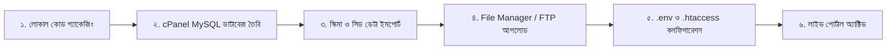

# Newslensbd (নিউজলেন্সবিডি) — Professional Bangla News Portal

> **ট্যাগলাইন (বাংলা):** সাধারণের বাইরে, সত্যের খোঁজে  
> **Tagline (English):** News Beyond the Ordinary  
> **টেকনোলজি পার্টনার:** [Stratifyx Global](https://stratifyxglobal.com)  
> **লাইভ ওয়েবসাইট:** [https://newslensbd.com](https://newslensbd.com)

---

## 🔑 দ্রুত অ্যাক্সেস ও লগইন ক্রেডেনশিয়াল (Quick Credentials & Access)

সিস্টেমের সকল অ্যাডমিন, লেখক, পাঠক ও ডাটাবেজের ক্রেডেনশিয়াল নিচে সুস্পষ্টভাবে প্রদান করা হলো:

### ১. অ্যাডমিন ও ইউজার লগইন তথ্য (Authentication Credentials)

| ভূমিকা (Role) | ইমেইল / ইউজার আইডি (Email / ID) | ডিফল্ট পাসওয়ার্ড (Password) | প্যানেল / লগইন লিঙ্ক (Access URL) |
| :--- | :--- | :--- | :--- |
| **সুপার অ্যাডমিন (Super Admin)** | `admin@newslensbd.com` | `password123` | **লাইভ:** [`https://newslensbd.com/lens-desk/login`](https://newslensbd.com/lens-desk/login)<br>**লোকাল:** [`http://localhost/NewsLens/public/lens-desk/login`](http://localhost/NewsLens/public/lens-desk/login) |
| **লেখক (Writer Panel)** | নিবন্ধিত লেখকের ইমেইল | লেখকের পাসওয়ার্ড | **লাইভ:** [`https://newslensbd.com/login`](https://newslensbd.com/login)<br>**ড্যাশবোর্ড:** [`https://newslensbd.com/writer/dashboard`](https://newslensbd.com/writer/dashboard) |
| **সাধারণ পাঠক (Reader)** | নিবন্ধিত পাঠকের ইমেইল | পাঠকের পাসওয়ার্ড | **লাইভ:** [`https://newslensbd.com/login`](https://newslensbd.com/login)<br>**বুকমার্ক:** [`https://newslensbd.com/user/bookmarks`](https://newslensbd.com/user/bookmarks) |

> [!TIP]
> **🧪 ইনস্ট্যান্ট টেস্টিং মাস্টার ওটিপি (Master Test OTP):**  
> নতুন পাঠক/লেখক নিবন্ধন, ইমেইল যাচাই বা পাসওয়ার্ড রিসেটের সময় যেকোনো ইমেইলের জন্য ওটিপি কোড হিসেবে **`123456`** ব্যবহার করুন। কোনো প্রকার ইমেইল ডেলিভারির জন্য অপেক্ষা না করেই তৎক্ষণাৎ অ্যাকাউন্ট ভেরিফাই হয়ে যাবে। এছাড়াও স্ক্রিনে এক ক্লিকেই ওটিপি অটো-ফিল করার সুবিধা রয়েছে।

### ২. ডাটাবেজ সংযোগ তথ্য (Database Configurations)

| পরিবেশ (Environment) | হোস্ট (Host) | পোর্ট (Port) | ডাটাবেজ নাম (DB Name) | ব্যবহারকারী (Username) | পাসওয়ার্ড (Password) |
| :--- | :--- | :--- | :--- | :--- | :--- |
| **লোকাল (Local XAMPP)** | `127.0.0.1` | `3306` বা `3307` | `newslensbd` | `root` | *(ফাঁকা / কোনো পাসওয়ার্ড নেই)* |
| **লাইভ সার্ভার (cPanel)** | `localhost` | `3306` | `lcxdiarj_newslens` | `lcxdiarj_lensuser` | `Lens#Secure2026!Db` |

---

## 📌 প্রজেক্ট ওভারভিউ (Project Overview)

**Newslensbd (নিউজলেন্সবিডি)** হলো সমগ্র বাংলাদেশের জাতীয়, আন্তর্জাতিক, ৮টি বিভাগ, ৬৪টি জেলা এবং উপজেলা পর্যায়ের সংবাদ প্রকাশের জন্য একটি আধুনিক, বিদ্যুৎগতির (< ২ সেকেন্ড লোড টাইম), মোবাইল-ফার্স্ট ও এসইও-বান্ধব পেশাদার বাংলা নিউজ পোর্টাল ও সিএমএস।

### 🎨 ব্র্যান্ড ও ডিজাইন সিস্টেম (Brand & UI Palette)
* **Primary (নেভি ব্লু - হেডার, শিরোনাম):** `#0b1f44` / `#0B2149`
* **Dark Theme (ডিপ নেভি মোড):** `#071630` / `#0c1e3d` (নো পিওর ব্ল্যাক, আরামদায়ক রিডিং)
* **Category Label (ক্যাটাগরি ব্যাজ):** জাতীয় সবুজ (`#0E7A3A`)
* **Breaking / Live (ব্রেকিং ও লাইভ ব্যাজ):** রক্তিম লাল (`#E31E24`)
* **ফন্ট ও টাইপোগ্রাফি:** Hind Siliguri / Noto Serif Bengali (Self-hosted)

---

## 🚀 প্রধান ফিচার ও মডিউলসমূহ (Core Modules)

### ১. মূল পোর্টাল ও পাবলিক ইন্টারফেস (Public Portal)
* **স্মার্ট শীর্ষবার (Top Bar):** স্বয়ংক্রিয় বাংলা ও হিজরি তারিখ রূপান্তরকারী (`BanglaDate`), লাইভ আবহাওয়া, ফন্ট সাইজার (অ-, অ, অ+), দ্বিভাষিক সুইচ (`[বাংলা | English]`) এবং ডার্ক/লাইট মোড টগল।
* **ব্রেকিং নিউজ টিকার:** লাল পালসিং ডট সহ মসৃণ অটো-স্লাইডার, হোভার পজ ও ম্যানুয়াল নেভিগেশন।
* **সারাদেশ ও ৬৪ জেলার সংবাদ (`/saradesh`):** ৮টি বিভাগ ও ৬৪টি জেলার ক্যাসকেডিং ড্রপডাউন ফিল্টার সহ দ্রুতগতিতে জেলাভিত্তিক সংবাদ পড়ার ব্যবস্থা।
* **সিঙ্গেল আর্টিকেল ও মিডিয়া প্লেয়ার:** ক্যাটাগরি, লেখক, প্রকাশের তারিখ, সোশ্যাল শেয়ারিং (Facebook, WhatsApp, X, Copy Link), সম্পর্কিত সংবাদ এবং পপআপ লাইটবক্সে ভিডিও প্লেব্যাক।
* **মাল্টি-ক্রাইটেরিয়া সার্চ (`/search`):** কীওয়ার্ড, ক্যাটাগরি, সময়সীমা (আজ, ৭ দিন, ৩০ দিন) এবং বিভাগ/জেলা ফিল্টার।
* **ইন্টারেক্টিভ সাইডবার উইজেট:** ডাটাবেজ-সংযুক্ত অনলাইন পাঠক জরিপ (Poll) লাইভ ভোট ও রিয়েলটাইম ফলাফল, নামাজের সময়সূচি, নিউজলেটার সাবস্ক্রিপশন এবং বিজ্ঞাপন স্লট।
* **PWA ও ওয়েব পুশ নোটিফিকেশন:** সার্ভিস ওয়ার্কার (`/sw.js`) ও ব্যাকগ্রাউন্ড পুশ সাপোর্ট (`/manifest.json`); নতুন ব্রেকিং নিউজ প্রকাশিত হওয়ামাত্রই সক্রিয় পাঠকদের নোটিফিকেশন অ্যালার্ট।

### ২. অ্যাডমিন কমান্ড ডেস্ক (`/lens-desk`)
* **সুরক্ষিত নন-ডিফল্ট রুট:** সাধারণ `/admin`-এর বদলে সুরক্ষায় `/lens-desk` পাথ ব্যবহৃত।
* **১০০% সার্বজনীন দ্বিভাষিক ইন্টারফেস (BN ⇄ EN):** অ্যাডমিন প্যানেলের প্রতিটি মেনু, বাটন, ফর্ম লেবেল, প্লেসহোল্ডার, মেট্রিক্স ও টেবিল এক ক্লিকে বাংলা বা ইংরেজিতে রূপান্তরযোগ্য (লগইনকারীর প্রেফারেন্স লোকালস্টোরেজে সিঙ্ক থাকে)।
* **লগইন স্ক্রিনে ইন্টারঅ্যাক্টিভ বাংলাদেশ ভেক্টর ম্যাপ:** ডার্ক মোডে লাল (`#E31E24`) ও লাইট মোডে সবুজ (`#0E7A3A`) রঙে রেন্ডার হওয়া স্কেলযোগ্য SVG ম্যাপ, নদী, সাগর এবং ঢাকার পালসিং বীকন।
* **মাল্টি-বাইলাইন নির্বাচন (Multi-Author Byline):** সংবাদ তৈরির সময় ৩ ধরনের লেখক অপশন:
  1. *অ্যাকাউন্ট নাম:* লগইনকৃত অ্যাডমিনের নাম।
  2. *বেনামী (Anonymous):* পরিচয় গোপন রেখে প্রকাশ।
  3. *কাস্টম বাইলাইন:* বিশেষ প্রতিনিধি, নিজস্ব প্রতিবেদক বা নির্দিষ্ট কোনো নাম।
* **সংবাদ ও মিডিয়া ব্যবস্থাপনা (`/lens-desk/posts`):** ড্রাফট, এডিটর রিভিউ, সরাসরি প্রকাশ, লোকাল ফাইল আপলোড বা সরাসরি ইমেজ URL ও ইউটিউব ভিডিও লিঙ্ক সাপোর্ট।
* **লেখক নিয়ন্ত্রণ ও অনুমোদন (`/lens-desk/writers`):** নতুন লেখকদের আবেদন পর্যালোচনা, অনুমতি স্তর নির্ধারণ (সরাসরি প্রকাশ বনাম সম্পাদকীয় পর্যালোচনা), সাময়িক স্থগিতকরণ এবং অডিট লগ ট্র্যাকিং।
* **বিজ্ঞাপন ও মনিটাইজেশন কন্ট্রোল (`/lens-desk/ads`):** ৫টি লাইভ কেপিআই (মোট বিজ্ঞাপন, চলমান, মোট ভিউ, ক্লিক, CTR) এবং স্ট্যান্ডার্ড সাইজ গাইডলাইন ট্র্যাকিং।
* **অনলাইন জরিপ ও পাঠক এনগেজমেন্ট (`/lens-desk/polls`):** নতুন পোল তৈরি, হোমপেজে সক্রিয়করণ, ভোট রিসেট এবং ডিলিট সুবিধা।
* **সাইট ব্র্যান্ডিং ও মেটা সেটিংস (`/lens-desk/settings`):** লোগো, পার্টনার লোগো, সম্পাদক/প্রকাশকের তথ্য, সরকারি নিবন্ধন নম্বর, সোশ্যাল লিঙ্ক ও ফুটার কনফিগারেশন।
* **আধুনিক অফক্যানভাস ড্রয়ার ও প্রোফাইল মোডাল:** রেসপনসিভ ৩-লাইন হ্যামবার্গার (`☰`) মেনু এবং হেডার থেকে দ্রুত নাম, মোবাইল ও পাসওয়ার্ড পরিবর্তনের মোডাল।

### ৩. লেখক ব্যবস্থাপনা ও ওয়ার্কফ্লো (`/writer`)
* **স্বতন্ত্র লেখক নিবন্ধন (`/writer/register`):** নাম, ইমেইল, মোবাইল ও লেখার আগ্রহ জানিয়ে বাংলা আবেদন ফরম।
* **অনুমোদন ব্যবস্থা:** অ্যাডমিন অনুমোদন না দেওয়া পর্যন্ত অ্যাকাউন্টটি `pending` থাকে এবং কোনো পোস্ট তৈরি করতে পারে না।
* **লেখক ড্যাশবোর্ড (`/writer/dashboard`):** মোট সংবাদ, প্রকাশিত, পর্যালোচনাধীন, প্রত্যাখ্যাত এবং মোট ভিউয়ের লাইভ কেপিআই মেট্রিক্স।
* **কঠোর মালিকানা নিরাপত্তা (Strict Ownership):** লেখকরা কেবল নিজের সংবাদ তৈরি ও সম্পাদনা করতে পারেন; অন্যের পোস্টে তাদের কোনো প্রবেশাধিকার নেই।
* **পাবলিক লেখক পেজ (`/author/{id}`):** লেখকের বায়ো, ছবি, সোশ্যাল মিডিয়া ও তার সকল প্রকাশিত প্রতিবেদনের সুবিন্যস্ত গ্রিড।

### ৪. পাঠক অ্যাকাউন্ট ও এনগেজমেন্ট (`/login`, `/register`)
* **বুকমার্ক ব্যবস্থা (`/user/bookmarks`):** পছন্দের যেকোনো খবর এক ক্লিকে বুকমার্ক (🔖) করে পরবর্তী সময়ে পড়ার সুবিধা।
* **সেলফ-সার্ভিস প্রোফাইল (`/profile`):** ছবি, বায়ো, যোগাযোগ ও পাসওয়ার্ড পরিবর্তনের পূর্ণ সুবিধা।
* **৩০-মিনিট ডুপ্লিকেট প্রতিরোধক ভিউ কাউন্টার:** প্রতিটি ইউনিক ভিউ হ্যাসড আইপি (`post_views`) দিয়ে সংরক্ষিত; একই ডিভাইস থেকে বারবার পেজ রিফ্রেশ করলেও ফেক ভিউ কাউন্ট হবে না।

---

## 🛡️ অধিকার ও পারমিশন ম্যাট্রিক্স (Role Permissions Matrix)

| বৈশিষ্ট্য / অ্যাকশন | সাধারণ পাঠক (Reader) | অনুমোদিত লেখক (Writer) | সুপার অ্যাডমিন / এডিটর (Admin) |
| :--- | :---: | :---: | :---: |
| **সংবাদ পড়া, সার্চ ও শেয়ার** | ✅ | ✅ | ✅ |
| **সংবাদ বুকমার্ক (Bookmark)** | ✅ | ✅ | ✅ |
| **ড্যাশবোর্ড প্রবেশাধিকার** | ❌ | ✅ (`/writer/dashboard`) | ✅ (`/lens-desk`) |
| **নতুন সংবাদ রচনা (`/posts/create`)** | ❌ | ✅ (নিজের নামে লকড) | ✅ (যেকোনো বাইলাইন/বেনামী) |
| **অন্যের সংবাদ সম্পাদনা/ডিলিট** | ❌ | ❌ | ✅ |
| **সরাসরি প্রকাশ (Direct Publish)** | ❌ | ⚡ (অ্যাডমিনের অনুমতি সাপেক্ষে) | ✅ (তাৎক্ষণিক লাইভ) |
| **সম্পাদকীয় পর্যালোচনা (Editor Review)**| ❌ | 📝 (অ্যাডমিন অনুমোদনের অপেক্ষায়) | ✅ (অনুমোদন/বাতিলকারী) |
| **ব্রেকিং ও লিড নিউজ নির্ধারণ** | ❌ | ❌ | ✅ |
| **বিজ্ঞাপন, জরিপ ও সাইট সেটিংস** | ❌ | ❌ | ✅ |
| **লেখক অনুমোদন ও নিয়ন্ত্রণ** | ❌ | ❌ | ✅ |

---

## 🛠 প্রযুক্তি কাঠামো (Tech Stack)

| স্তর | প্রযুক্তি বিবরণ |
| :--- | :--- |
| **Frontend** | Semantic HTML5, Vanilla CSS3 (Custom Design System, Zero External CSS Frameworks), Vanilla ES6+ JS |
| **Backend** | PHP 8.2+ (Lightweight MVC Architecture, PSR-4 Autoloading, PDO Prepared Statements) |
| **Database** | MySQL 8.0+ / MariaDB (`utf8mb4_unicode_ci` বাংলা ফন্টের নিখুঁত রেন্ডারিংয়ের জন্য) |
| **Security** | CSRF Token Protection, XSS Sanitization, Password Hashing (`bcrypt`), RBAC Server-side Middleware |
| **Web Server** | Apache / Nginx (mod_rewrite সক্রিয়, HTTPS বাধ্যতামূলক) |
| **Background Cron** | PHP CLI (`cron/send_notifications.php`) |

---

## 🗂 ডিরেক্টরি কাঠামো (Directory Structure)

```text
NewsLens/
├── public/                 # ওয়েব রুট (একমাত্র পাবলিক ফোল্ডার)
│   ├── index.php           # ফ্রন্ট কন্ট্রোলার ও সেন্ট্রাল রাউটার এন্ট্রি পয়েন্ট
│   ├── assets/             # স্ট্যাটিক এসেট (CSS, JS, Fonts, Images)
│   │   ├── css/style.css   # মাস্টার স্টাইলশিট (Dark Mode, Responsive, Brand Tokens)
│   │   ├── js/main.js      # ক্লায়েন্ট স্ক্রিপ্ট (Theme toggle, Modals, Ajax filters)
│   │   └── img/            # সাইট লোগো ও ভেক্টর উপাদান
│   └── uploads/            # সংবাদ ও প্রোফাইলের আপলোডকৃত ছবি
├── app/
│   ├── Controllers/        # HomeController, NewsController, SaradeshController, Admin/*
│   ├── Models/             # Post, Category, District, Setting, User, Ad, Poll
│   ├── Views/              # MVC টেমপ্লেট ভিউ ফাইল
│   │   ├── layouts/        # main.php
│   │   ├── partials/       # header.php, breaking_ticker.php, footer.php
│   │   ├── pages/          # home.php, saradesh.php, single.php, category.php, author.php
│   │   └── admin/          # dashboard.php, posts_index.php, writers_index.php, settings.php
│   ├── Core/               # Router, Database, Auth, View, Middleware
│   └── Helpers/            # BanglaDate (বাংলা তারিখ, সংখ্যা ও সময় রূপান্তরকারী)
├── config/
│   ├── config.php          # গ্লোবাল এপ্লিকেশন কনফিগারেশন
│   └── .env.example        # এনভায়রনমেন্ট ভেরিয়েবল টেমপ্লেট
├── database/
│   ├── schema.sql          # সম্পূর্ণ প্রোডাকশন স্কিমা (টেবিল স্ট্রাকচার)
│   ├── seed_initial.sql    # ৮ বিভাগ, ৬৪ জেলা, ১৪ ক্যাটাগরি, ডিফল্ট অ্যাডমিন ও সেটিংস সিড
│   └── migrations/         # ডাটাবেজ মাইগ্রেশন স্ক্রিপ্ট
├── storage/                # সিস্টেম লগ, ফাইল ক্যাশ ও ব্যাকআপ
└── README.md               # মূল প্রজেক্ট ডকুমেন্টেশন
```

---

## 💻 লোকাল সেটআপ গাইড (Local Setup Guide - XAMPP)

### ধাপ ১: XAMPP সার্ভার চালু করুন
1. **XAMPP Control Panel** ওপেন করুন।
2. **Apache** এবং **MySQL** মডিউলের **Start** বাটনে ক্লিক করুন।

### ধাপ ২: ডাটাবেজ তৈরি ও ইমপোর্ট
1. ব্রাউজারে প্রবেশ করুন: [http://localhost/phpmyadmin](http://localhost/phpmyadmin)
2. **New**-এ ক্লিক করে ডেটাবেজ নাম দিন: `newslensbd` এবং Collation নির্বাচন করুন: `utf8mb4_unicode_ci`।
3. `newslensbd` ডেটাবেজটি নির্বাচন করে **Import** ট্যাবে যান:
   - প্রথমে `database/schema.sql` ফাইলটি নির্বাচন করে **Import** করুন (টেবিলসমূহ তৈরি হবে)।
   - এরপর `database/seed_initial.sql` ফাইলটি নির্বাচন করে **Import** করুন (ডিফল্ট অ্যাডমিন, ক্যাটাগরি ও জেলা ডেটা লোড হবে)।

### ধাপ ৩: `.env` কনফিগারেশন
প্রজেক্টের মূল ডিরেক্টরিতে থাকা `.env.example`-কে কপি করে `.env` নামে সেভ করুন:
```ini
DB_HOST=127.0.0.1
DB_PORT=3307        # আপনার MySQL পোর্ট (3306 বা 3307)
DB_NAME=newslensbd
DB_USER=root
DB_PASS=            # কোনো পাসওয়ার্ড না থাকলে ফাঁকা রাখুন
```

### ধাপ ৪: লোকাল পোর্টাল ভিজিট করুন
* 🌐 **হোমপেজ:** [`http://localhost/NewsLens/public/`](http://localhost/NewsLens/public/)
* 📍 **সারাদেশ:** [`http://localhost/NewsLens/public/saradesh`](http://localhost/NewsLens/public/saradesh)
* 🔐 **অ্যাডমিন ডেস্ক:** [`http://localhost/NewsLens/public/lens-desk`](http://localhost/NewsLens/public/lens-desk) *(লগইন: `admin@newslensbd.com` / `password123`)*

---

## 🌐 লাইভ সার্ভার ডিপ্লয়মেন্ট ও ইউআরএল ডিরেক্টরি (Live Deployment)

Newslensbd পোর্টালটি লাইভ cPanel হোস্টিং সার্ভারে সংযুক্ত ও কনফিগার করা হয়েছে।

### ১. লাইভ অ্যাক্সেস ডিরেক্টরি (All Live URLs)

| পোর্টাল / পেজ (Page) | সরাসরি লাইভ লিঙ্ক (URL) | অ্যাক্সেস ভূমিকা (Access Role) |
| :--- | :--- | :--- |
| **লাইভ মূল পোর্টাল** | [`https://newslensbd.com/`](https://newslensbd.com/) | সর্বসাধারণ (Public Readers) |
| **সারাদেশ বিভাগ ও জেলা সংবাদ** | [`https://newslensbd.com/saradesh`](https://newslensbd.com/saradesh) | সর্বসাধারণ |
| **ক্যাটাগরি আর্কাইভ (যেমন: জাতীয়)** | [`https://newslensbd.com/category/national`](https://newslensbd.com/category/national) | সর্বসাধারণ |
| **পাবলিক লেখক প্রোফাইল** | [`https://newslensbd.com/author/1`](https://newslensbd.com/author/1) | সর্বসাধারণ |
| **অ্যাডমিন কমান্ড ডেস্ক লগইন** | [`https://newslensbd.com/lens-desk/login`](https://newslensbd.com/lens-desk/login) | Super Admin (`admin@newslensbd.com` / `password123`) |
| **অ্যাডমিন মূল ড্যাশবোর্ড** | [`https://newslensbd.com/lens-desk`](https://newslensbd.com/lens-desk) | Super Admin / Editor |
| **অ্যাডমিন লেখক নিয়ন্ত্রণ প্যানেল** | [`https://newslensbd.com/lens-desk/writers`](https://newslensbd.com/lens-desk/writers) | Super Admin |
| **বিজ্ঞাপন ও অ্যানালিটিক্স ডেস্ক** | [`https://newslensbd.com/lens-desk/ads`](https://newslensbd.com/lens-desk/ads) | Super Admin |
| **লেখক নিবন্ধন ফরম** | [`https://newslensbd.com/writer/register`](https://newslensbd.com/writer/register) | নতুন আবেদনকারী লেখক |
| **লেখক ড্যাশবোর্ড** | [`https://newslensbd.com/writer/dashboard`](https://newslensbd.com/writer/dashboard) | অনুমোদিত লেখক (Active Writer) |
| **লেখক নতুন সংবাদ রচনা** | [`https://newslensbd.com/writer/posts/create`](https://newslensbd.com/writer/posts/create) | অনুমোদিত লেখক |
| **আমার সংবাদসমূহ (লেখক তালিকা)** | [`https://newslensbd.com/writer/posts`](https://newslensbd.com/writer/posts) | অনুমোদিত লেখক |
| **সাধারণ পাঠক লগইন** | [`https://newslensbd.com/login`](https://newslensbd.com/login) | পাঠক ও লেখক |
| **সাধারণ পাঠক নিবন্ধন** | [`https://newslensbd.com/register`](https://newslensbd.com/register) | নতুন সাধারণ পাঠক |
| **সংরক্ষিত খবর (Bookmarks)** | [`https://newslensbd.com/user/bookmarks`](https://newslensbd.com/user/bookmarks) | লগইনকৃত পাঠক |
| **ব্যবহারকারী প্রোফাইল ও সেটিংস** | [`https://newslensbd.com/profile`](https://newslensbd.com/profile) | নিবন্ধিত যেকেউ |
| **পাসওয়ার্ড রিসেট (ইমেইল ওটিপি)** | [`https://newslensbd.com/forgot-password`](https://newslensbd.com/forgot-password) | পাসওয়ার্ড ভুলে যাওয়া ইউজার |
| **সার্বজনীন লগআউট (Universal Logout)** | [`https://newslensbd.com/logout`](https://newslensbd.com/logout) | যেকোনো সক্রিয় সেশন |

---

### ২. সার্ভার ডিপ্লয়মেন্ট আর্কিটেকচার



1. **cPanel ডাটাবেজ প্রস্তুতকরণ:**
   - cPanel **MySQL® Database Wizard** থেকে ডাটাবেজ `lcxdiarj_newslens` এবং ব্যবহারকারী `lcxdiarj_lensuser` তৈরি করে সম্পূর্ণ প্রিভিলেজ প্রদান করা হয়েছে।
   - `database/schema.sql` এবং `database/seed_initial.sql` সফলভাবে ইমপোর্ট করা হয়েছে।
2. **ফাইল প্যাকেজিং ও আপলোড:**
   - প্রজেক্টের কোর ডিরেক্টরিগুলো সার্ভারের `public_html`-এ আপলোড ও কনফিগার করা হয়েছে।
3. **লাইভ প্রডাকশন `.env` কনফিগারেশন:**
   ```ini
   APP_NAME="Newslensbd"
   APP_ENV=production
   APP_DEBUG=false
   APP_URL=https://newslensbd.com

   DB_HOST=localhost
   DB_PORT=3306
   DB_NAME=lcxdiarj_newslens
   DB_USER=lcxdiarj_lensuser
   DB_PASS=Lens#Secure2026!Db

   ADMIN_PATH=lens-desk
   ```
4. **সার্ভার সিকিউরিটি `.htaccess`:** রুট `.htaccess`-এর মাধ্যমে সরাসরি ডিরেক্টরি ব্রাউজিং রোধ এবং সমস্ত ট্রাফিক নিরাপদে ফ্রন্ট কন্ট্রোলারে রিডাইরেক্ট নিশ্চিত করা হয়েছে।

---

## 🛠️ সাম্প্রতিক সমস্যা সমাধান ও অপ্টিমাইজেশন (Technical Optimizations)

1. **লেখক পেজে HTTP 500 ত্রুটি সমাধান:**
   - `AuthorController.php`-তে `short_bio` ও `bio` কলামের বৈষম্য দূর করতে `COALESCE` কোয়েরি হ্যান্ডলিং প্রয়োগ।
   - ব্রাউজারে `/public/author/1` কিংবা সরাসরি `/author/1` যেকোনো ফরম্যাটে ভিজিট করলেও `Router.php`-তে পাথ নরমালাইজেশনের মাধ্যমে নিখুঁত রেন্ডারিং নিশ্চিত।
   - `Auth.php`-তে সেশন হেডার প্রেরণের পূর্বে `!headers_sent()` গার্ড যুক্ত করে ওয়ার্নিং ও সেশন লুপ প্রতিরোধ।
2. **লেখক পোস্ট ক্রিয়েশন ও ড্যাশবোর্ড আর্কিটেকচার ইউনিফিকেশন:**
   - অ্যাডমিন ও লেখক উভয় প্যানেলের হেডারে প্রিমিয়াম ইউনিফাইড নেভিগেশন ও অফক্যানভাস ড্রয়ার যুক্ত।
   - লেখক পোস্টে ক্যাটাগরি, জেলা ও ইমেজ ড্রপডাউনে ভ্যালিডেশন শক্তিশালীকরণ এবং সার্ভার-সাইড রোল এনফোর্সমেন্ট।
3. **ডাইনামিক ক্যানোনিকাল পোস্ট ইউআরএল:**
   - এসইও ও সাইটের পারফরম্যান্স বজায় রাখতে সকল পোস্ট লিঙ্ক `/news/{category_slug}/{id}/{slug}` প্যাটার্নে সমন্বিত।

---

## 🔄 ফিউচার আপডেট ও ডেভেলপমেন্ট গাইড (Future Updates FAQ)

ভবিষ্যতে নতুন ফিচার বা কোড পরিবর্তন সংক্রান্ত গুরুত্বপূর্ণ নির্দেশিকা:

| পরিবর্তনের ধরন | phpMyAdmin ডেটাবেজ লাগবে? | কীভাবে সার্ভারে যুক্ত করবেন? |
| :--- | :---: | :--- |
| **নতুন কোড/ডিজাইন (PHP, HTML, CSS, JS)** | **না (দরকার নেই)** | শুধুমাত্র পরিবর্তিত ফাইলটি cPanel **File Manager** বা **FTP** দিয়ে আপলোড/রিপ্লেস করবেন। সাথে সাথে লাইভ হয়ে যাবে। |
| **সংবাদ, ছবি, জরিপ বা বিজ্ঞাপন প্রকাশ** | **না (কখনোই না)** | সরাসরি অ্যাডমিন প্যানেল ([`https://newslensbd.com/lens-desk`](https://newslensbd.com/lens-desk)) থেকে এডিট বা পোস্ট করবেন। |
| **নতুন ডেটাবেজ টেবিল বা কলাম** | **হ্যাঁ (শুধুমাত্র স্কিমা পরিবর্তনের ক্ষেত্রে)** | নতুন ফিচারের জন্য নতুন টেবিল বা কলাম লাগলে cPanel **phpMyAdmin**-এ ঢুকে শুধু সংশ্লিষ্ট `CREATE TABLE` বা `ALTER TABLE` কোয়েরিটি একবার রান করলেই হবে। |

---

© 2026 **Newslensbd** | ডেভেলপমেন্ট ও টেকনিক্যাল পার্টনার: **[Stratifyx Global](https://stratifyxglobal.com)**
